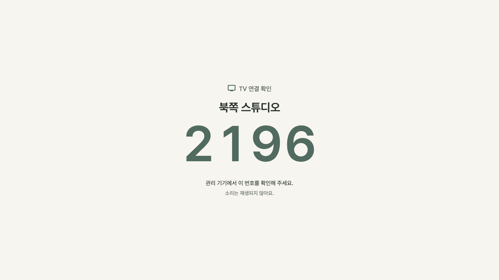

# STA-167 · TV 연결 확인 화면

TV 연결 확인 오버레이가 스스로 `Material`과 텍스트 기본 스타일을 소유하도록 수정했다. Oat Sage 바탕 위에 TV 이름과 확인 번호를 구분하고, 짧은 안내를 중앙에 배치한다. 확인 번호는 연결 완료 표시가 아니다.

## 문제와 확인 범위

사용자 사진에는 빨간 큰 글자와 노란 이중 밑줄이 보인다. 사진을 촬영한 앱 버전·빌드, 기기 모델, 실제 해상도·배율과 진입 경로는 제공되지 않아 미확인이다. 기준 소스 `38a2f60`의 `DisplayModeScreen` 식별 오버레이는 `Stack` 위 `ColoredBox` 아래에서 부분 `TextStyle`만 지정한다. 그 위치에는 `Material` 텍스트 경계가 없어 상위 라우트의 기본 스타일이 섞일 수 있다.

회귀 테스트는 빨강·노랑 이중 밑줄·monospace 기본 스타일을 상위에 주입한 뒤 실제 `RichText`에 적용된 색, 글꼴, 굵기와 장식을 검사한다. 이는 코드 경계의 수정 근거이며, 사용자 TV에서 원인을 재현했다고 주장하지 않는다. 실제 TV release 빌드 검수는 사용자 후속 검수로 남긴다.

## 적용한 시각 규칙

현재 `AppColors` 토큰을 사용한다. 바탕 `canvas #F7F5EF`, 이름·주 안내 `ink #2B332E`, 보조 안내 `muted #616B63`, 번호·아이콘 `accent #526B60`이다. 과거 후보 색과 새 다크 테마는 사용하지 않는다. 기본 텍스트는 Pretendard, 400, 자간 0, 장식 없음이며 이름·번호는 600이다. 이름 자간은 -1%, 번호는 고정폭 숫자와 4% 자간을 적용한다.

| 논리 뷰포트 조건 | 제목 | TV 이름 | 번호 | 주 안내 | 최대 내용 폭 |
| --- | ---: | ---: | ---: | ---: | ---: |
| 높이 480 미만 | 16 | 24 | 76 | 14 | 폭 조건에 따름 |
| 폭 1000 미만 | 18 | 28 | 112 | 16 | 800 |
| 720p: 1280×720 | 20 | 36 | 160 | 20 | 800 |
| 1080p: 1920×1080 | 24 | 44 | 192 | 22 | 960 |
| 4K: 3840×2160 | 36 | 72 | 384 | 36 | 1200 |

단위는 Flutter 논리 픽셀이다. 네이티브 DPR에 따라 물리 해상도와 논리 뷰포트가 다를 수 있으므로 물리 해상도만으로 4K 규칙 적용을 가정하지 않는다. 가장자리 안전 여백은 각 축의 5%이며 가로 24–192, 세로 24–108 범위와 플랫폼 `SafeArea`를 함께 사용한다.

전체 화면을 비례 확대하지 않는다. 제목과 안내는 시스템 글자 배율을 반영한다. 긴 이름은 전체 문구를 먼저 줄바꿈한 뒤 이름 영역만 축소해 번호와 겹치지 않게 한다. 이미 가장 큰 번호는 시스템 글자 배율을 중복 적용하지 않으며 네 자리를 유지한다. 아주 작은 뷰포트에는 스크롤 안전 장치를 둔다. 테스트한 720p/1080p/4K × 1/1.5/2배에서는 모든 내용이 안전 여백 안에 들어와 스크롤 없이 보인다.

## 기존 동작 보존과 주변 화면 점검

`DisplayModeScreen`의 현재 기기 선택, 서버 시간 기반 만료 판단, 연결 상태, 수업 중 숨김, 확인 ACK 로직은 변경하지 않았다. 번호도 기존 식별 ID의 마지막 네 자리다. 불투명한 확인 화면이 표시되는 동안만 뒤의 대기 콘텐츠를 배치하지 않는다. 이 조치는 720p·2배 실제 화면 캡처에서 발견된 숨은 대기 콘텐츠 overflow를 막는다. 확인 종료 후 기존 대기 화면으로 복귀하며 센터 콘텐츠의 스타일이나 저장 데이터는 변경하지 않는다.

| 주변 시스템 화면 | 경계 점검 결과 |
| --- | --- |
| 미연결·페어링·네트워크 오류 대기 | `_DisplayStandby`의 `Scaffold` 경계 존재 |
| 페어링 QR 카드 | `DisplayPairingCard`의 `Material` 존재, 주변 안내는 대기 `Scaffold` 아래 |
| 재생 복구 안내 | `PlaybackRecoveryView`의 `Material`, `inherit: false`, 명시적 Pretendard/장식/스크롤 존재 |
| TV 업데이트 안내 | `TvAppUpdateGate`의 `Material` 존재 |
| 센터 대기 콘텐츠 | `StoreWelcomeBoard` 두 경로 모두 `Scaffold` 존재; 사용자 콘텐츠 색 유지 |
| 표시/관리 전환 제어 | `DeviceModeToggle`의 `Material` 존재 |

주변 화면에서 같은 텍스트 경계 누락은 발견하지 못했다. 사용자 슬라이드, 타이머 운동·휴식 색, 센터 대기 콘텐츠, 수업 플레이어에는 테마를 덮어쓰지 않았다.

## 검증과 캡처

- VM 회귀·캡처 33개 통과: 신규 스타일·레이아웃 13개, 기존 display flow/복구/브리핑 테마/페어링 회귀, 실제 위젯 캡처 5개.
- 최종 4K 위계 보완 후 신규 UI·캡처 18개 재실행 통과.
- Chrome 26개 통과: 신규 스타일·레이아웃·프로토콜 및 기존 display flow/복구/페어링.
- `flutter analyze`: No issues found.
- 신규 테스트는 세 기기의 실제 이름·번호 선택, 각 기기 ACK, 무음, 서버 시계 만료, 종료 후 대기 복귀, 진행 중 수업과 오프라인에서 식별/ACK가 발생하지 않음을 검사한다.

아래 PNG는 실제 `DisplayModeScreen`에 테스트용 전송 계층을 주입한 Flutter VM 렌더링이다. 폰트를 실제 앱 자산에서 로드했으며 네트워크·실제 TV·운영 ACK 쓰기는 사용하지 않았다. `web-1080p.png`는 비 Android TV 분기 캡처이며 실제 브라우저 캡처는 아니다. 브라우저 동작은 별도의 Chrome 위젯 테스트로 확인했다.

| 캡처 | 조건 |
| --- | --- |
| [720p](screenshots/tv-720p.png) | Android TV 분기, 메인 디스플레이, 0584 |
| [1080p](screenshots/tv-1080p.png) | Android TV 분기, 북쪽 스튜디오, 2196 |
| [4K](screenshots/tv-4k.png) | Android TV 분기, 3층 스트레칭 공간, 8740 |
| [긴 이름·2배](screenshots/tv-720p-long-name-2x.png) | 720p, 긴 한국어 이름, 시스템 글자 2배 |
| [웹 표시 분기](screenshots/web-1080p.png) | 1080p, 표시/관리 전환 제어 포함 |



재현 명령:

```sh
flutter test test/display_identification_overlay_test.dart test/display_mode_flow_test.dart test/playback_recovery_test.dart test/workout_briefing_theme_boundary_test.dart test/pairing_qr_test.dart tool/sta167_capture_test.dart
flutter test --platform chrome test/display_identification_overlay_test.dart test/display_mode_flow_test.dart test/playback_recovery_test.dart test/pairing_qr_test.dart
flutter analyze
```

## 후속 실기기 검수

실기기/배포 빌드 검수와 운영 배포는 수행하지 않았다. 사용자 검수 시 네이티브 TV 및 웹 TV의 앱 버전·빌드, 기기 모델, 물리 해상도·DPR·논리 뷰포트, 글자 배율과 진입 경로를 기록한다. 세 TV에 서로 다른 이름·번호가 관리 앱과 일치하는지, 실제 무음과 ACK, 확인 종료·만료 후 복귀, 수업 중 미표시를 확인한다. 720p/1080p/4K, 긴 이름, 1/1.5/2배, TV 오버스캔과 3–5m 거리의 가독성도 확인한다.
