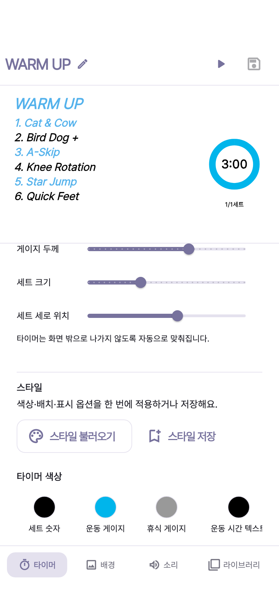
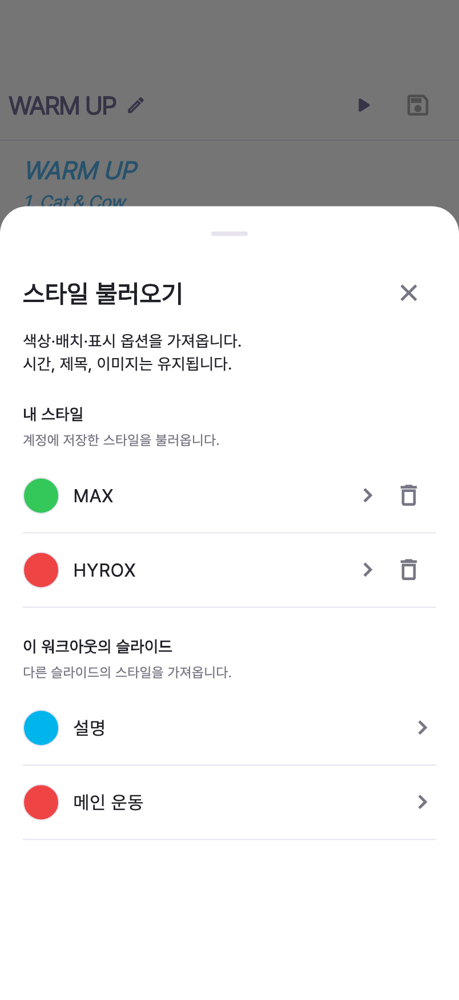
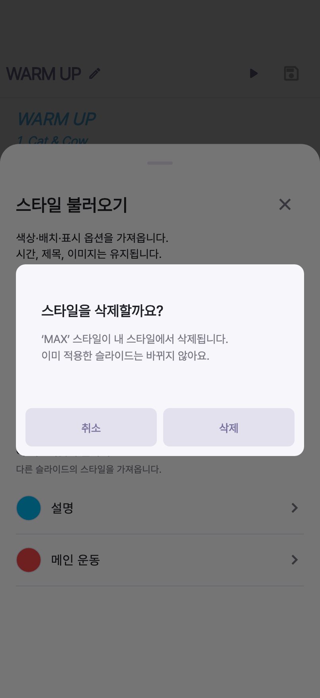

# STA-113 스타일·타이머 설정 레이아웃

실제 `SlideEditorScreen` 위젯을 402 × 874 논리 픽셀에서 렌더링한 결과입니다. 저장된 스타일과 워크아웃은 재현 가능한 로컬 예제 데이터이며, 기기 상태 표시줄을 포함한 Simulator 캡처는 아닙니다.

| 타이머 설정 | 스타일 불러오기 | 삭제 확인 |
| --- | --- | --- |
|  |  |  |

- 스타일 불러오기·저장 버튼을 타이머 색상 바로 위에 배치했습니다.
- 기본 스타일과 ‘이 기기’ 문구를 제거하고, 내 스타일과 다른 슬라이드 목록을 제목·설명·구분선으로 정리했습니다.
- 삭제 전 확인을 받고, 삭제 성공 후에도 목록을 열어 둡니다. 실패하면 항목을 유지하고 재시도할 수 있습니다.
- 색상 라벨은 글자 길이에 맞춰 폭을 확보합니다. 좁은 화면에서는 가로로 스크롤해 나머지 색상을 선택합니다.

## 재현

저장소 루트에서 실행합니다. 아래 명령은 이 폴더의 PNG 3개를 갱신합니다.

```sh
flutter test --no-pub tool/sta113_layout_capture_test.dart
```

## 검증

- `flutter analyze --no-pub`: 이슈 없음
- `flutter test --no-pub`: 702개 통과
- Chrome에서 편집 기능·4개 화면 크기·스타일 삭제/재시도·색상 선택 테스트 23개 통과
- 200% 글자 크기에서 긴 색상 라벨과 스타일 이름, 삭제 확인 버튼 접근 검증

```sh
flutter test --no-pub --platform chrome test/slide_editor_features_test.dart test/slide_editor_tabs_test.dart test/slide_style_picker_test.dart test/color_picker_palette_test.dart
```
