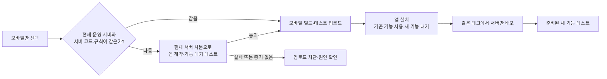

# 모바일을 먼저 설치하고 서버를 나중에 배포하기

운영 앱 `com.sunmkim.cloudboard`를 TestFlight·Play 내부 테스트로 먼저 업로드하고, 설치 후 같은 후보의 서버만 배포할 수 있다. 스토어 처리·설치 가능 여부·일반 공개는 업로드 성공과 별도로 확인한다.



## 실행 순서

1. 새 기능이 현재 서버의 기존 API·데이터 형식에서 동작하거나, 새 서버가 필요하면 **해당 기능만 대기/비활성 상태**가 되도록 구현한다. 현재 앱의 저장·수업·TV 기능은 유지한다. 서버가 없거나 응답이 잘못됐거나 오프라인일 때도 새 동작을 시작하지 않아야 한다.
2. 서버 코드가 다른 후보는 아래 검증 명세와 실제 테스트를 함께 커밋해 인계한다. 명세는 기능 개발·릴리즈 담당자가 관리하며, 각 실행 때 사용자에게 승인 체크박스를 요구하는 방식이 아니다.
3. main에 반영된 고정 후보에서 **Start production release → 모바일만 선택**한다. CI가 현재 운영 backend receipt를 읽고, 서버 사본에서 계약 검사를 실행한다. 두 플랫폼은 같은 검증 결과를 재사용한다. 일반 CI 생략 옵션은 이 호환성 검사를 우회하지 않는다.
4. TestFlight·Play 처리 후 앱을 설치한다. 이때 새 서버를 기다리는 기능은 아직 실행하지 않는다.
5. 같은 후보의 서버를 올릴 때는 **Deploy Flutter Web to Firebase Hosting**을 기존 `vX.Y.Z` 태그에서 수동 실행한다. `scope=backend`, `deploy_mobile=false`, 정확한 `confirm_sha`를 지정한다. 서버·규칙을 배포하고 앱은 재빌드하지 않는다. 새 서버 코드로 바뀌었다면 새 고정 후보·일치하는 새 태그가 필요하다.
6. 서버 배포 및 smoke 성공을 확인하고 새 기능을 테스트한다. 기능 준비 신호·활성 조건은 해당 기능의 구현을 따른다. 이 릴리즈 도구가 Remote Config나 운영 정책을 임의로 켜지는 않는다.

## 후보별 검증 명세

파일은 `release-notes/mobile-compatibility.json`이다. 현재 서버와 후보 서버의 지문이 같으면 이 파일 없이 기존 빠른 경로를 사용한다. 다르면 파일이 필수이며 빈 선언이나 “호환됨” 체크 하나로 통과시키지 않는다.

앱 코드를 확정한 커밋에서 아래 읽기 전용 명령으로 명세에 넣을 지문을 구한다. backend SHA는 성공한 실제 운영 backend receipt에서 확인한다. 이 명령은 Git 소스를 읽을 뿐 현재 운영 상태를 조회하지 않는다. CI와 업로드 단계가 실제 운영 receipt를 다시 확인한다.

```sh
node tool/release/verify_mobile_backend.mjs fingerprints <확인된-운영-backend-SHA>
```

아래는 형식 예시이며 성공 증거가 아니다. 파일 경로·설명·지문은 실제 후보에 맞게 작성한다.

```json
{
  "schemaVersion": 1,
  "clientFingerprint": "<명령이 출력한 앱 지문>",
  "backendFingerprint": "<명령이 출력한 운영 서버 지문>",
  "reviewedBy": "<검토 담당자>",
  "summary": "기존 API로 기본 기능 유지. 새 서버 기능은 준비 응답 전까지 대기.",
  "emulatorSuites": ["functions/test/mobile-new-feature-emulator.mjs"],
  "clientTests": ["test/mobile_current_server_test.dart"],
  "deferredFeatures": [{
    "id": "newFeature",
    "beforeServer": "waiting",
    "guard": "lib/src/app/feature/example/server_readiness.dart",
    "test": "test/mobile_new_feature_waiting_test.dart"
  }]
}
```

- `emulatorSuites`: 실제로 현재 서버가 받아야 하는 callable 입력·응답, 읽기·쓰기 및 실패 처리를 확인하는 관련 테스트. 후보의 테스트가 **현재 운영 서버 소스**를 불러 사용한다. 테스트 파일은 `functions/test/*-emulator.mjs` 형식이다. 모든 emulator endpoint는 로컬이어야 한다.
- `clientTests`: 현재 서버에서 앱의 기존 흐름이 유지되는 Flutter 테스트. 필요하면 `MOBILE_BACKEND_FIXTURE_DIR` 아래의 고정된 서버 사본·응답 fixture를 사용한다. mock만 썼다면 실제 SDK·기기 검증으로 기록하지 않는다.
- `deferredFeatures`: 새 서버가 필요한 기능의 실제 guard 소스와 테스트. `beforeServer`는 `waiting` 또는 `disabled`다. 서버 미준비·오프라인·잘못된 응답·오래된 캐시에서 차단, 서버 준비 이후 정상 동작, 기존 기능 유지까지 검사한다. 새 서버 의존 기능이 없다면 빈 배열로 명시한다. **이 목록만으로 앱에 guard가 자동 구현되지는 않으며**, 해당 소스와 테스트를 기능 구현에 포함해야 한다.

앱 지문에는 `lib`, iOS/Android 설정, assets/config, 의존성·Flutter 버전, `test`와 DTO exporter가 포함된다. 앱 입력이 바뀌면 명세도 재검토해야 한다. 서버만 바뀐 사실은 앱 지문을 바꾸지 않는다. 검증 결과는 추가로 정확한 후보 SHA에 묶인다.

## 자동 검사와 증거

`mobile-backend-compatibility` 작업은 모바일을 선택했고 서버를 배포하지 않는 `verify`/`web` 범위에서 실행된다. 현재 서버와 코드가 같으면 SDK 설치 없이 종료한다. 다른 경우:

1. 브랜치나 worktree를 전환하지 않고 `build/release/mobile-backend-sandbox`에 후보 테스트와 운영 서버 소스·규칙·의존성을 조합한다. 아직 배포하지 않은 후보 Functions 파일은 제거한다.
2. 후보 Flutter 코드에서 실제 저장·재생 DTO를 내보내고, 명세의 현재 서버/대기 동작 테스트를 실행한다.
3. 기본 저장·재생·Storage 규칙 계약과 명세의 관련 callable 계약을 `demo-cloudboard` 로컬 에뮬레이터에서 실행한다. 운영 DB·스토어에는 연결하거나 쓰지 않는다. 테스트 전후 서버 입력 지문이 실제 receipt와 같은지 확인한다.
4. 전체가 성공해야 `release.json`을 생성한다. artifact에는 후보 SHA·태그, 앱/서버 지문, 서버 소스, run/attempt, 검증 명세·테스트 소스 해시, 검사 결과와 대기 기능을 기록한다.

모바일은 SDK 설치 전과 업로드 직전에 이 artifact의 해시, 실제 성공 작업·단계, 최신 실행 회차와 현재 운영 서버를 확인한다. 실패·취소·미실행, 누락·만료·변조된 artifact, 다른 후보·태그·서버 증거는 거절한다. 나중 서버가 후보 서버와 정확히 같아졌다면 기존 동일 코드 경로로 통과할 수 있다. 마지막으로 확인한 운영 서버는 `mobile-backend-reference-<run>-<attempt>` artifact에 별도 보존한다.

웹 및 규칙만 배포할 때의 기존 서버 일치 검사, 기존 설치 앱·TV·웹 계약 검사, 태그 고정·main 포함·서명·빌드 번호·환경 검사는 유지한다.

이 증거는 테스트에 포함된 소스·에뮬레이터 동작을 확인한다. 실제 기기·오프라인 SDK·스토어 심사·일반 공개·모든 사용자 데이터의 동작을 자동으로 증명하지 않는다. 필요한 실제 앱 검증은 기능 인계 기록에 별도로 남긴다.
